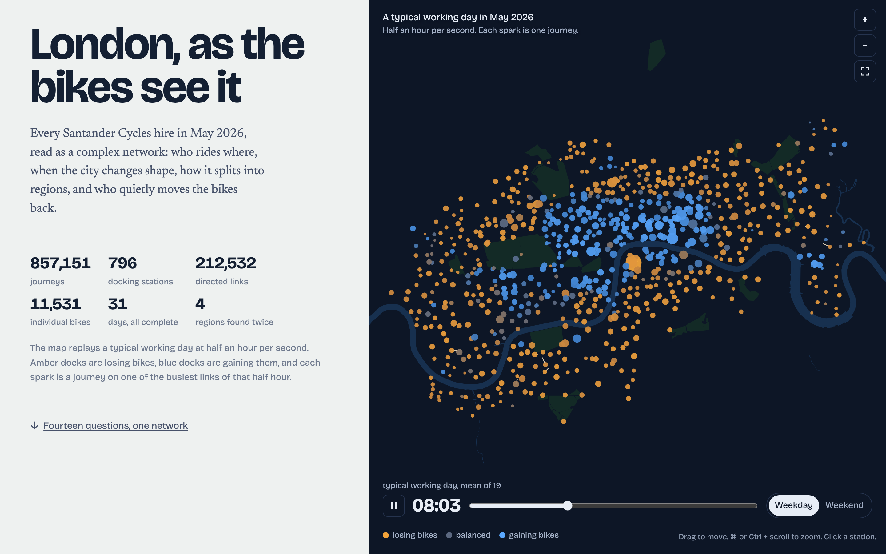

# London, as the bikes see it

**A complex-network study of 857,151 Santander Cycles journeys (May 2026), told as an interactive essay.**

**[Open the essay →](https://aleetreny.github.io/santander-cycles-network/)**



Docking stations are nodes and hires are directed, weighted links. Fourteen chapters each ask one question and answer it with one family of network-science tools. A single canvas, the *instrument*, reconfigures itself as you scroll: it replays a working day, filters the backbone, colours regions, closes stations, and morphs London into flow space. The essay ends with an explorer that gathers every measure for any of the 801 stations.

## What it finds

| Question | Method | Finding |
|---|---|---|
| What is the network? | Directed weighted graph, Poisson null for reciprocity | 796 stations and 212,532 links, density 34%. The binary graph is nearly saturated, so the signal is in the weights. |
| Are there hubs? | Clauset–Shalizi–Newman tail fits, Vuong tests, Lorenz/Gini | No scale-free stations, because dock capacity caps them. Link weights are log-normal (Gini 0.54), and 13% of links carry half the trips. s ∝ k^1.26. |
| Which links matter? | Disparity filter (Serrano et al. 2009) | At α = 0.001, 2,578 links keep 767 stations. A weight threshold of the same size keeps 660. The backbone is a small world. |
| What does distance explain? | Doubly constrained gravity (IPF + Poisson MLE), radiation model | Exponential decay of 0.57/km reproduces 55% of flows (CPC). Radiation fails (14%). |
| Is the Thames a barrier? | River-crossing term on OpenStreetMap geometry | Crossing costs about 0.48 km of extra riding. Below 1 km, cross-river pairs get 71% of predicted trips. |
| Which corridors beat geography? | Standardised gravity residuals | Student halls to campuses (Great Dover Street → Kingsway/LSE), park loops in Hyde Park, Bow ↔ Mile End. |
| Who is central? | PageRank, HITS, eigenvector, betweenness/closeness on effective distance (Brockmann–Helbing) | Strength ≈ PageRank (τ 0.93). Betweenness singles out bridges: St James's Square, Bank, Waterloo. |
| Are there regions? | Leiden over resolutions and seeds, weighted configuration null, Infomap, Laplacian eigengap | 4 regions, Q = 0.374 (z ≈ 1,565 vs null). Infomap agrees (NMI 0.81). The eigengap gives an east–west split at the top level. |
| Who bridges them? | Guimerà–Amaral roles | 20 connector hubs: King's Cross, Waterloo, Soho, Old Street, London Bridge, Liverpool Street. |
| Higher-order structure? | Weighted rich club, assortativity, directed triad census vs 40 degree-preserving rewirings | Rich club 7× for the top 10. Neutral mixing. Fully reciprocal triangles z ≈ 1,000. |
| When does it change? | 48 hourly layers, cosine similarity, k-means regimes, time-resolved PageRank | Five regimes. Morning and evening station balances r = −0.93. The centre moves Bank → Exhibition Road → Waterloo. |
| What kinds of station exist? | k-means on 96-dimensional rhythms | Six archetypes. Railway termini behave like homes. |
| Where would bikes pile up? | Markov chain, spectral gap, out-of-sample check on September occupancy | A bike forgets its start after about 4 rides. May flows predict September dock changes (r = 0.67; median 0.80 per station). |
| Who moves the bikes back? | Trajectory reconstruction from 11,531 bike ids | 37,139 hidden relocations. The operator mirrors the riders (ρ = −0.97) and cancels 87% of their imbalance. |
| What would break it? | Targeted vs random closures, edge percolation, topological overlap (Onnela et al. 2007) | The backbone shatters after about 25% of busiest stations close. Weak ties bridge, strong ties sit inside neighbourhoods. |
| Do e-bikes make another network? | Multiplex overlap (Battiston et al. 2014) | Longer trips, slower decay, few return trips. Only 8% of the backbone is shared with classic bikes. |
| What does London look like in flow space? | t-SNE, force layout, spectral coordinates, Procrustes | The flow map keeps 99.6% trustworthiness and is still London (ρ 0.94 with geography). |

Numbers in the essay are filled in from the data files when the page loads, so the text cannot drift away from the charts after a rebuild.

## Run it

```bash
python3 tools/serve.py 4180     # then open http://127.0.0.1:4180
```

The published data is committed under `site/data/`, so no Python is needed to view the essay.

## Rebuild the study

```bash
python3.12 -m venv .venv && source .venv/bin/activate
pip install -r requirements-study.txt pytest     # exact versions used; requirements.txt has ranges
python -m cycles inventory && python -m cycles fetch && python -m cycles stations && python -m cycles prepare
python -m cycles trips          # clean, deduplicate, match to docks  → data/derived/trips.parquet
python -m cycles build --fresh  # every chapter (~6 min)               → site/data/*.json
pytest -q
```

`cycles build` caches each chapter in `data/derived/cache/`. Without `--fresh`, it recomputes only the chapters whose cache files are missing. Seeds are fixed (42). The occupancy validation also needs the September 2026 BikePoint archive under `data/occupancy/`, fetched by `cycles/occupancy.py`. The Thames and park outlines in `data/osm/` come from OpenStreetMap.

## Layout

```
cycles/
  acquire.py, prepare.py   TfL S3 inventory, download, schema normalisation to Parquet
  occupancy.py             BikePoint occupancy archive (September 2026)
  trips.py                 stage 1: one clean, station-matched journey table
  geo.py                   Thames and parks basemap, river-crossing matrix
  analysis/                one module per family of methods
    structure.py           distributions, centrality, mixing, cores, rich club, motifs
    backbone.py            disparity filter
    space.py               gravity, radiation, river penalty, residual corridors
    communities.py         Leiden, Infomap, null models, roles
    temporal.py            hourly layers, regimes, commute symmetry, archetypes, the animated day
    flows.py               Markov drift, relocations, occupancy validation
    robustness.py          closures, percolation, weak ties
    layers.py              multiplex comparison
    embedding.py           t-SNE, force and spectral layouts
  build.py                 runs the chapters and writes the site's JSON
site/                      static page: HTML, CSS, ES modules, d3, self-hosted fonts
tests/                     unit tests on toy graphs + consistency checks on the published JSON
```

## Data and licences

- Journeys: [TfL cycle hire usage stats](https://cycling.data.tfl.gov.uk/), extracts 443–444 (1–31 May 2026). Powered by TfL Open Data. Contains OS data © Crown copyright and database rights 2016 and Geomni UK Map data © and database rights 2019.
- Stations: [TfL BikePoint API](https://api.tfl.gov.uk/BikePoint), snapshot 20 October 2026.
- Occupancy: [feregrino/london-cycles](https://huggingface.co/datasets/feregrino/london-cycles), CC BY-SA 3.0. Derived occupancy numbers are shared under the same licence.
- River and parks: © OpenStreetMap contributors, ODbL.
- Fonts: Bricolage Grotesque and Newsreader (SIL OFL). d3 (ISC). Code: MIT.

Limits are stated in the essay. In short: lines join docks and are not routes ridden, a hire is not a person, one month cannot separate season from habit, relocations are inferred, and closure curves assume no rerouting.
